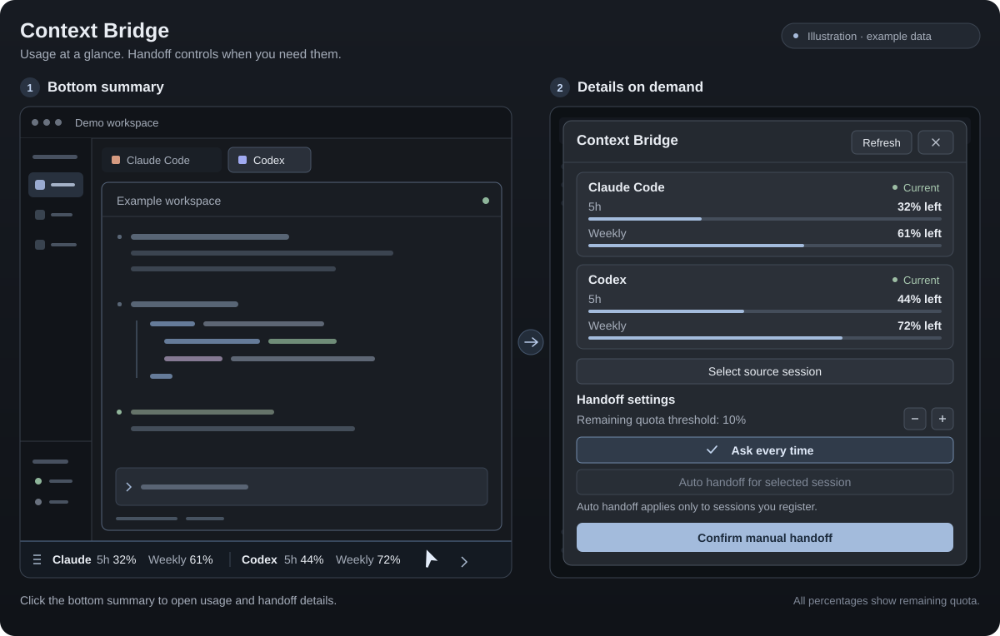

# Herdr Context Bridge

[English](README.md) | [한국어](README.ko.md) | [日本語](README.ja.md) | [简体中文](README.zh-CN.md)

Herdr で Claude Code と Codex のアカウント残量を確認し、上限が近づいたときに同じ作業フォルダの新しいターミナルへ作業履歴を引き継ぐ、macOS とネイティブ Windows 向けのローカルツールです。既定は **毎回承認** です。自動引き継ぎは、選択した引き継ぎ元セッションに対してユーザーが明示的に有効にする必要があります。

Node.js の組み込みモジュールのみを使用し、別の Web サーバーやパッケージのインストールは不要です。

AGY（Antigravity CLI）の使用量表示と通知にも対応しています。会話の引き継ぎは Claude/Codex 間で利用できます。公式インターフェースでアカウントの使用を確認したプロバイダーだけを表示します。Codex は使用量取得の成功、Claude/AGY は有効なステータスラインの割当量データが基準です。インストール・設定ファイルの存在や `authenticating` だけでは表示しません。既存の有効なキャッシュも認め、以後の取得失敗時には表示を維持して取得不可・古い情報を示します。これは観測履歴であり、現在のログイン状態の検査ではありません。

既存の環境では `npm run install:mod` で更新してください。AGY の `~/.gemini/antigravity-cli/settings.json` に wrapper を追加し、元のコマンドの stdin・stdout・stderr・終了コードとユーザー設定を保持します。新規設定は標準ステータスラインの下に表示し、明示的に無効化した設定は変更しません。ログイン済みセッションから通常のデータが届くと表示され、テスト用プロンプトは不要です。**更新**は Claude/AGY の収集済みデータを再読込します。

AGY の公式 [`statusLine` の `quota`](https://antigravity.google/docs/cli/statusline/) を使用します。下部の要約には、ユーザーが代表項目に指定した Gemini4 Argon の `gemini-argon-wtu-weekly` だけを **AGY 週間 XX%** と表示し、ツールチップにモデル名・元の bucket ID・リセット時刻を示します。この bucket がなければ別の週間枠には切り替えず、**AGY 週間 —** と表示します。価格の自動判定ではなく、ユーザーが選んだ代表項目です。詳細と通知では全 bucket の元の名前と残り割合・リセットを維持します。期間の推測や bucket の合算はせず、`remaining_amount` だけの場合は割合を表示しません。無効な bucket は取得不可とし、AGY の通知から引き継ぎ確認を開くことはありません。



*サンプルデータを使ったイラストです。実際のスクリーンショットではありません。*

## 対応言語

下部の要約・詳細画面と helper は英語（`en`）、韓国語（`ko`）、日本語（`ja`）、中国本土の簡体字中国語（`zh-CN`）に対応しています。macOS では優先する言語リストの先頭を使用し、繁体字中国語を含む非対応言語の場合は英語を表示します。先頭が非対応でも、リスト内の別の言語は選びません。Windows、または macOS の言語設定を取得できない場合は、`LC_ALL`、`LC_MESSAGES`、`LANG`、`Intl` の順に参照します。Windows の優先言語 API は別途呼び出しません。個別の手動言語設定はありません。`node src/cli.mjs locale` は、自動引き継ぎポリシーを評価せずに、検出した言語を `{ "locale": "ja" }` のような JSON で返します。

## 必要な環境

- macOS またはネイティブ Windows、Herdr アプリ、`herdr-app` と `hc` コマンド。Herdr 0.1.10 を対象に作成しています。
- Node.js 22.5 以降、`git`（Windows では Git for Windows）、引き継ぎに使う各プロバイダーの `claude`・`codex` CLI。Windows ではアプリの `PATH` に `node` が必要です。
- 各 CLI で正常にログイン済みの現在のローカルプロファイル。アプリが起動する helper の `PATH` からも CLI を見つけられる必要があります。
- `app-server`、アカウント使用量 API、full thread history API に対応する Codex。Codex を対象とする新しいタブでは `--no-daemon` を使用します。
- Windows の CLI はネイティブの `.exe`・`.com` と標準 npm `.cmd` shim に対応し、shim の Node またはネイティブの実行対象を直接起動します。プロンプト引数をシェル展開で変えないため、任意の `.cmd`・`.bat` スクリプトは CLI 起動用として対応しません。

CI は `macos-latest` と `windows-latest` を対象に設定しています。この変更は macOS で開発・検証しており、Windows 実機の Herdr アプリでの動作はまだ検証していません。

リモートの Herdr マシンや、複数の認証プロファイルの同時管理には対応していません。ログインアカウントを変更する前に **毎回承認** に切り替え、使用量とセッションの関連付けを再確認してください。

## インストールとアンインストール

Herdr を一度起動して既定のレイアウトを作成し、リポジトリをクローンしてインストールします。macOS では次を実行します。

```sh
git clone https://github.com/photojupi/herdr-context-bridge.git
cd herdr-context-bridge
npm run install:mod -- --dry-run
npm run install:mod
herdr-app check ~/.config/herdr-app/mods/context-bridge
herdr-app do layout.switch '{"name":"context-bridge"}'
```

Windows では PowerShell を使います。

```powershell
git clone https://github.com/photojupi/herdr-context-bridge.git
cd herdr-context-bridge
npm.cmd run install:mod -- --dry-run
npm.cmd run install:mod
herdr-app check "$env:USERPROFILE/.config/herdr-app/mods/context-bridge"
herdr-app do layout.switch --name context-bridge
```

上のパスは Herdr の既定の設定フォルダを前提としています。インストーラーは [Herdr の `app_dir()`](https://github.com/herdrdev/herdr-app/blob/master/src/mods.rs) に従い、`HERDR_APP_HOME`、`XDG_CONFIG_HOME/herdr-app`、Windows の `USERPROFILE/.config/herdr-app` または macOS の `HOME/.config/herdr-app` の順に選びます。上書き設定がある場合は `herdr-app check` にもそのフォルダを指定してください。この文書の `~` は各ユーザーのホームフォルダです。

既定ではインストーラーは個人用 mod と helper を `~/.config/herdr-app/mods/context-bridge/` にコピーし、既定の `main` レイアウトを複製した `layouts/context-bridge.json` の既存の下部ステータスバーと同じ行に残量の要約を配置します。ステータスバーの高さは維持し、ステータスバーがないレイアウトには下部に一行追加します。再インストールすると従来の右パネルをこの構成に置き換え、要約を重複させません。組み込み mod と元の `main.json` は変更しません。インストールコマンド自体は画面のレイアウトを切り替えません。

Claude の `~/.claude/settings.json` にステータスラインの wrapper と hooks を追加し、Codex の `~/.codex/hooks.json` に hooks を追加します。既存の hooks は保持します。既存の Claude ステータスラインコマンドには元の stdin を渡し、出力と終了コードを維持します。初回の設定バックアップと変更ファイル一覧は `~/.local/state/herdr-context-bridge/install.json` に保存します。再インストール前にユーザーがステータスラインコマンドを変更した場合、その新しいコマンドを wrapper の呼び出し元コマンドとして使用し、初回のファイルバックアップは保持します。

Windows では元の Claude ステータスラインを Git Bash があればそのシェルで、なければ PowerShell で実行します。AGY は既定の Windows コマンドシェルを使います。引き継ぎには `/usr/bin/env` に代えて Node ランチャーを使い、引数と環境変数を保持します。

Codex では `/hooks` など CLI の通常の手順で、インストールされた hooks を信頼する必要がある場合があります。既存のセッションには新しい hooks がすぐ反映されないことがあるため、後述の手動のセッション関連付けを利用してください。Claude の使用量はインストールだけでは表示されず、該当セッションで API 応答後にステータスライン入力が届くと表示されます。

アンインストールの前に元のレイアウトへ戻します。以下は既定の `main` を使う例です。

```sh
herdr-app do layout.switch '{"name":"main"}'
npm run uninstall:mod -- --dry-run
npm run uninstall:mod
```

Windows では次を実行します。

```powershell
herdr-app do layout.switch --name main
npm.cmd run uninstall:mod -- --dry-run
npm.cmd run uninstall:mod
```

アンインストーラーは追加した hooks とステータスラインの wrapper を取り除き、以前のコマンドを復元します。インストール後に変更したステータスラインのオプションと、無関係な設定は保持します。他の管理対象ファイルもインストール時の内容と一致する場合にのみ削除・復元し、ユーザーが変更したファイルは結果の `preserved` に表示して残します。**引き継ぎ原文・作業状態・バックアップはアンインストール後も保持されます。** 最後のインストール記録は、同じデータフォルダの `last-install.json` に残ります。

## 使い方

1. 下部のステータス行で Claude・Codex の **5 時間・週間の残量**を確認します。プロバイダーと期間を区別し、平均や合算は行いません。取得できない値は `—`、古い値は別表示とし、有効な残量がしきい値以下なら警告します。Codex の期間には実際のウィンドウのメタデータを使い、不明な期間は推測しません。要約をクリックすると、使用量カード、リセット・更新時刻、**更新**、引き継ぎ設定、引き継ぎ元の選択、最近の処理、既存の手動引き継ぎ確認を含む詳細画面を開きます。閉じる操作または Escape で、ターミナルのサイズを変えずにコーディング画面へ戻れます。60 秒ごとに更新され、**更新** で手動取得もできます。
2. **元セッションを選択** でローカルターミナルを選び、同じ作業フォルダのセッション候補を確認します。hooks が関連付けできなかった既存セッションもここで手動で関連付けます。最新のファイルが自動で引き継ぎ元になることはありません。
3. **手動引き継ぎを確認** で引き継ぎ元・引き継ぎ先・フォルダ・保存範囲を確認し、**引き継ぐ** を押します。引き継ぎ元が作業中、または通常の承認待ちの場合は保留します。
4. 引き継ぎ先の新しいタブで、初期プロンプトの受け渡し、履歴の読み取り、作業再開を確認します。詳細画面の **対象ターミナルを起動しました** はタブ作成の応答を受け取ったという意味で、モデルが全履歴を読んだことを示すものではありません。

残量のしきい値は既定で 10% で、設定で 1～50% に変更できます。最初に観測した値が既にしきい値以下でも通知します。同じプロバイダー・使用量ウィンドウ・リセット周期の重複通知は、アプリの共有状態で抑制します。**後で** を押すと確認画面を閉じます。

### 自動引き継ぎ

関連付け済みの引き継ぎ元を選び、**選択セッションを自動引き継ぎ** で登録します。次の条件をすべて満たす必要があります。

- 自動モードで、その引き継ぎ元セッションが登録されている。
- 引き継ぎ元のセッション・ターミナル・作業フォルダが関連付けられ、状態が `idle` または `done` である。確認済みの `rate_limit` エラーによる `blocked` も許可する。
- 引き継ぎ元の最新かつ有効な残量がしきい値以下である。
- もう一方のプロバイダーの CLI があり、引き継ぎ先の最新かつ有効な残量がしきい値を超えている。
- 同じ引き継ぎ元で自動実行を試みた履歴がなく、自動引き継ぎで作成されたセッションでもない。

準備後に引き継ぎ元の状態と自動実行条件を再確認します。収集不可、古い値、期限切れのウィンドウ、不明確な関連付け、作業中の場合は自動実行しません。引き継ぎ先の使用量を確認できなければ手動確認が必要です。同じ引き継ぎ元での重複実行をロックで防ぎ、自動作成したセッションを再び自動で切り替えません。新しいタブは引き継ぎ元ターミナルのローカルスペースに作成し、準備中にスペースが変わると中止します。Codex の連続した問い合わせでアカウント識別子の変更が確認された場合、自動登録を解除します。

**失敗した自動引き継ぎは自動で再試行しません。** エラーを確認してから手動で再試行してください。準備プロセスが停止した場合、その後の状態取得で失敗として処理します。引き継ぎ先の作成開始後に中断し、結果が不明な場合は重複防止のためロックを維持するので、まず新しい引き継ぎタブの有無を確認してください。**毎回承認** は自動登録を解除します。

詳細画面を閉じても下部の要約は常駐し、使用量の更新、処理状況の取得、通知、自動引き継ぎの監視を続けます。アプリの下部の要約による状態取得が自動ポリシーを実行します。アプリを閉じている間も監視を続ける独立サービスはありません。既に開始した引き継ぎ準備 worker は別プロセスです。

## 残量の意味と認証

| プロバイダー | 収集インターフェース | 確認できる情報 |
| --- | --- | --- |
| Codex | 公式 `codex app-server` の `account/rateLimits/read` | 現在の CLI アカウントが返す複数の制限 bucket と使用量ウィンドウ。従来の単一 `rateLimits` 形式にも対応 |
| Claude Code | 公式 `statusLine` stdin の `rate_limits` | ステータスラインに実際に渡される、5 時間・7 日などのサブスクリプション／支出ウィンドウ。最初の API 応答までは存在しない場合がある |

表示値は **アカウント制限ウィンドウの残り割合** です。特定のセッションのコンテキストトークン残量や、今後可能なリクエスト回数ではありません。欠損値を 100% と推測せず、リセット時刻を過ぎても自動で満量にはしません。10 分以上前の値は古い情報として表示し、自動判断には最新の有効な値だけを使用します。公式 API が利用不可を明示した場合、割合が残っていても利用可能とは判断しません。

使用量の取得は会話を実行したりセッションを再開したりしない読み取りリクエストですが、Codex CLI がネットワークリクエストや自身の認証更新を行う場合があります。helper が認証ファイル・トークン・Keychain を直接読んだり、認証情報を抽出したりすることはありません。収集するのは、正規化した使用量、API が提供するアカウント識別子、セッション識別子・パス・ターミナルの関連付けなど必要なメタデータです。

## 保存する内容

- Claude のメイン会話と検出した subagent の JSONL を固定バイト境界でコピーし、サイズと SHA-256 を記録します。メッセージ、ツール呼び出し・結果、圧縮要約、以前の branch を原文に保持します。
- Codex は利用可能な raw rollout を保存し、公式 `thread/turns/list` の `itemsView: full` を全 cursor ページにわたり昇順で保存します。raw パスのない保存形式では、公式の full history を保持し、raw がないことを明記します。
- 大きな履歴も原文を要約で置き換えたり、末尾を黙って切り捨てたりしません。読み取り用の分割ファイルとバイトインデックスを作成し、途切れた最後の JSONL や解析できない大きな record などには警告を残します。
- 作業フォルダ、Git HEAD・状態・未コミットの diff・staged diff を記録します。ソースファイルや Git の状態を変更せず、diff も適用しません。未追跡ファイルの内容を含むプロジェクト全体の別途バックアップではありません。
- 原文に含まれる画像データと添付参照は保持しますが、外部添付そのもののコピーやアクセス可能性は保証しません。

引き継ぎディレクトリの `START_HERE.md` に、読む順番、最新の branch、圧縮区間を記載します。`manifest.json`、`records.jsonl`、`raw/`、`chunks/`、Codex の `turns-*.json`、`git-*.txt` を一緒に保存します。失敗したエクスポートは `FAILED.json` で区別します。引き継ぎ先には長い原文そのものではなく、このローカルインデックスのパスを初期プロンプトとして渡します。

引き継ぎ元セッションを終了せず、入力も送りません。引き継ぎ先 CLI の既定の承認・サンドボックスを維持し、権限を回避するオプションは付けません。**原文の保存はモデルの全コンテキストの複製とは異なります。** 実行中のツール・プロセス、モデル内部のニューラルネットワーク状態、元の製品のシステムプロンプトは移せません。引き継ぎ先のコンテキスト長と実際にファイルを読む範囲にも左右されるため、全履歴の読み取りを確認する前に完全な複製とは主張しません。

## 保存先とコマンド

既定のデータ保存先は Windows では `USERPROFILE/.local/state/herdr-context-bridge`、macOS では `HOME/.local/state/herdr-context-bridge` です。設定、使用量キャッシュ、セッションの関連付け、引き継ぎ jobs、ロック、`bundles/`、インストール時のバックアップをソースリポジトリの外に保存します。POSIX では新しいデータディレクトリを 0700、ファイルを 0600 の権限で作成し、Windows ではユーザープロファイルフォルダの ACL 権限が適用されます。bundle には会話・ツール結果が含まれるので、共有前に内容を確認してください。自動の保存期限や削除機能はありません。

| コマンド | 用途 |
| --- | --- |
| `npm test` | ローカル回帰テスト |
| `npm run check` | JavaScript の構文検査 |
| `node scripts/smoke.mjs` | 一時 HOME と偽 CLI で手動・自動引き継ぎ全体の実行境界を検証 |
| `npm run install:mod -- --dry-run` | インストールで変更するパスを確認 |
| `npm run install:mod` | 個人用 mod・helper・レイアウト・hooks のインストールまたは更新 |
| `npm run uninstall:mod -- --dry-run` | 削除・保持する対象を確認 |
| `npm run uninstall:mod` | インストールによる変更を取り除き、データは保持 |
| `node src/cli.mjs status` | 使用量・関連付け・jobs を取得し、現在の自動ポリシーを評価 |
| `node src/cli.mjs locale` | 検出した表示言語を読み取り専用で取得 |
| `node src/cli.mjs config` | 現在の設定を取得 |
| `node src/cli.mjs config '{"mode":"ask","autoSessions":[]}'` | 自動登録を解除 |
| `node src/cli.mjs sessions claude /absolute/workdir` | Claude のセッション候補を取得。`codex` にも対応 |
| `node src/cli.mjs bind '<JSON>'` | `terminalId`、`provider`、`id`、`cwd` で候補を関連付け |
| `node src/cli.mjs handoff '<JSON>'` | `sourceKey`、`target`、`automatic:false`、任意の `space` で手動引き継ぎを要求 |
| `node src/cli.mjs job <jobId>` | 特定の引き継ぎジョブを取得 |

公開の取得・設定・引き継ぎコマンドは JSON を出力し、エラー時は `{ "error": "…" }` と失敗の終了コードを返します。`capture`、`statusline`、`worker`、`launch` はインストールされた hooks と helper が使う内部コマンドです。`status` は自動モードでは実行を引き起こす場合があるため、読み取り専用コマンドとして扱わないでください。

| 環境変数 | 用途 |
| --- | --- |
| `HERDR_BRIDGE_STATE_DIR` | helper のデータ保存先を変更。開発・分離テスト向けに推奨し、インストーラー・アプリ・hooks で同じ値を使う必要がある |
| `HERDR_APP_HOME` | インストール先の Herdr 設定フォルダを変更。`XDG_CONFIG_HOME` より優先 |
| `XDG_CONFIG_HOME` | `HERDR_APP_HOME` が未設定の場合、配下の `herdr-app` を Herdr 設定フォルダとして使用 |
| `HC_TERMINAL_ID` | Herdr が hooks に渡す引き継ぎ元ターミナル識別子 |

インストーラーは既定の `~/.claude` と `~/.codex` の設定を対象にします。CLI の個別の認証・設定ディレクトリを複数運用する構成は、このインストール手順の対応範囲外です。

運用・画面構成は [RECIPE.md](RECIPE.md)、変更履歴は [CHANGELOG.md](CHANGELOG.md) を参照してください。公式インターフェースは [Codex app-server](https://learn.chatgpt.com/docs/app-server)、[Codex hooks](https://learn.chatgpt.com/docs/hooks)、[Claude ステータスライン](https://code.claude.com/docs/en/statusline)、[Claude hooks](https://code.claude.com/docs/en/hooks) に記載されています。

## ライセンス

[MIT ライセンス](LICENSE)を適用します。Copyright (c) 2026 photojupi.
