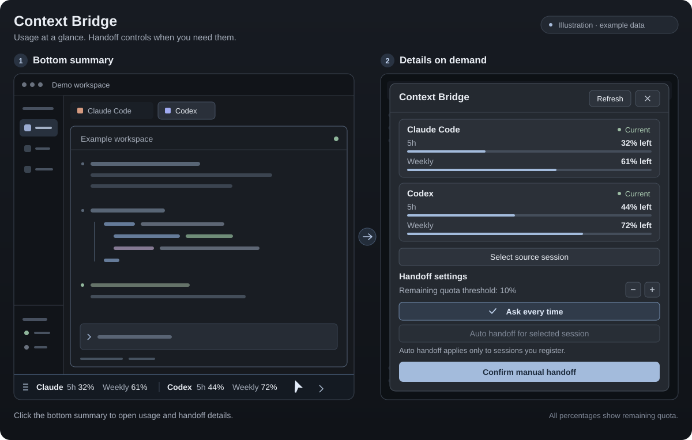

# Herdr Context Bridge

[English](README.md) | [한국어](README.ko.md) | [日本語](README.ja.md) | [简体中文](README.zh-CN.md)

Herdr에서 Claude Code와 Codex의 계정 잔여량을 확인하고, 한도가 부족해지면 같은 작업 폴더의 새 터미널로 작업 기록을 인계하는 로컬 macOS 도구입니다. 기본값은 **매번 승인**입니다. 자동 인계는 사용자가 선택한 원본 세션에 직접 켜야 합니다.

Node.js 기본 모듈만 사용하며 별도 웹 서버나 패키지 설치는 필요하지 않습니다.



*예시 데이터를 사용한 일러스트이며 실제 스크린샷이 아닙니다.*

## 지원 언어

하단 요약·상세창과 helper는 영어(`en`), 한국어(`ko`), 일본어(`ja`), 중국 본토 간체 중국어(`zh-CN`)를 지원합니다. macOS의 선호 언어 목록에서 첫 번째 언어를 사용하며, 지원하지 않는 언어와 번체 중국어는 영어로 표시합니다. 지원하지 않는 첫 번째 언어를 건너뛰고 목록의 다른 언어를 고르지는 않습니다. macOS 언어 설정을 읽을 수 없을 때만 `LC_ALL`, `LC_MESSAGES`, `LANG`, `Intl` 순서로 확인합니다. 별도 수동 언어 설정은 없습니다. `node src/cli.mjs locale`은 자동 정책을 실행하지 않고 감지된 언어를 `{ "locale": "ko" }` 같은 JSON으로 조회합니다.

## 준비

- macOS, Herdr 앱과 `herdr-app`·`hc` 명령. Herdr 0.1.10을 대상으로 작성했습니다.
- Node.js 22.5 이상, `git`, 인계할 제공자의 `claude`·`codex` CLI.
- 각 CLI에서 정상적으로 로그인한 현재 로컬 프로필. 앱이 실행하는 helper의 `PATH`에서도 CLI를 찾을 수 있어야 합니다.
- Codex의 `app-server`, 계정 사용량 API와 full thread history API를 지원하는 버전. Codex 대상으로 새 탭을 열 때 `--no-daemon`을 사용합니다.

원격 Herdr 머신과 여러 인증 프로필을 동시에 관리하는 기능은 포함하지 않습니다. 로그인 계정을 바꿀 때는 먼저 **매번 승인**으로 전환하고 사용량과 세션 연결을 다시 확인하세요.

## 설치와 제거

Herdr를 한 번 실행해 기본 레이아웃을 만든 뒤 저장소를 복제하고 설치합니다.

```sh
git clone https://github.com/photojupi/herdr-context-bridge.git
cd herdr-context-bridge
npm run install:mod -- --dry-run
npm run install:mod
herdr-app check ~/.config/herdr-app/mods/context-bridge
herdr-app do layout.switch '{"name":"context-bridge"}'
```

설치기는 개인 mod와 helper를 `~/.config/herdr-app/mods/context-bridge/`에 복사하고, 기본 `main` 레이아웃을 복제한 `layouts/context-bridge.json`의 기존 하단 상태바 옆에 잔여량 요약을 배치합니다. 기존 상태바 높이는 유지하며, 상태바가 없는 레이아웃에는 하단 한 줄을 추가합니다. 재설치하면 기존 우측 패널을 이 구성으로 교체하고 요약을 중복으로 만들지 않습니다. 내장 mod와 원본 `main.json`은 수정하지 않습니다. 설치 명령 자체는 화면 레이아웃을 전환하지 않습니다.

Claude의 `~/.claude/settings.json`에 상태줄 wrapper와 hooks를 추가하고, Codex의 `~/.codex/hooks.json`에 hooks를 추가합니다. 기존 hooks는 유지합니다. 기존 Claude 상태줄 명령에는 원래 stdin을 전달하고 출력과 종료 코드를 유지합니다. 최초 설정 백업과 변경 파일 목록은 `~/.local/state/herdr-context-bridge/install.json`에 저장합니다. 재설치 전 사용자가 상태줄 명령을 바꿨다면 그 새 명령을 wrapper의 원본으로 사용하며 최초 파일 백업은 보존합니다.

Codex에서는 설치한 hooks를 `/hooks` 등 CLI의 정상 절차로 신뢰해야 할 수 있습니다. 기존 실행 세션은 새 hooks를 즉시 반영하지 않을 수 있으므로 아래의 수동 세션 연결을 이용하세요. Claude 사용량은 설치만으로 생기지 않으며, 해당 세션에서 API 응답 후 상태줄 입력이 들어와야 표시됩니다.

제거할 때는 먼저 원래 레이아웃으로 돌아갑니다. 아래 예시는 기본 `main`입니다.

```sh
herdr-app do layout.switch '{"name":"main"}'
npm run uninstall:mod -- --dry-run
npm run uninstall:mod
```

제거기는 추가한 hooks와 상태줄 wrapper를 걷어 내고 기존 명령을 복원합니다. 설치 후 변경한 상태줄 옵션과 무관한 설정은 유지합니다. 다른 관리 파일도 설치 당시 내용과 같을 때만 제거·복원하며, 사용자가 바꾼 파일은 결과의 `preserved`에 표시하고 남겨 둡니다. **인계 원문·작업 상태·백업은 제거 후에도 보관**합니다. 마지막 설치 기록은 같은 데이터 폴더의 `last-install.json`에 남습니다.

## 사용 방법

1. 하단 상태바 행에서 Claude·Codex의 **5시간·주간 잔여량**을 확인합니다. 제공자와 기간은 각각 구분하며 평균·합산하지 않습니다. 조회 불가는 `—`, 오래된 값은 별도 표시하고 유효한 잔여량이 기준 이하이면 경고합니다. Codex 기간은 실제 창 메타데이터를 사용하며 불명확한 기간은 추측하지 않습니다. 요약을 클릭하면 사용량 카드, 리셋·갱신 시각, **새로고침**, 인계 설정, 원본 선택, 최근 작업과 기존 수동 인계 확인을 담은 상세창을 엽니다. 닫기 또는 Escape로 터미널 크기를 바꾸지 않고 코딩 화면으로 돌아갑니다. 60초마다 갱신하며 **새로고침**으로 직접 조회할 수 있습니다.
2. **원본 세션 선택**에서 로컬 터미널을 고르고 같은 작업 폴더의 세션 후보를 확인합니다. hooks가 연결하지 못한 기존 세션도 여기서 직접 연결합니다. 가장 최근 파일을 자동으로 원본으로 선택하지 않습니다.
3. **수동 인계 확인**에서 원본·대상·폴더·보존 범위를 확인한 뒤 **인계하기**를 누릅니다. 원본이 작업 중이거나 일반 승인을 기다리면 인계를 보류합니다.
4. 대상의 새 탭에서 초기 프롬프트 전달과 기록 읽기, 작업 재개를 확인합니다. 상세창의 **대상 터미널 실행됨**은 탭 생성 응답을 받았다는 뜻이며 모델이 모든 기록을 읽었다는 확인은 아닙니다.

잔여량 기준은 기본 10%이며 설정에서 1~50% 범위로 바꿀 수 있습니다. 처음 관측한 값이 이미 기준 이하라도 알립니다. 같은 제공자·사용량 창·리셋 주기의 알림은 앱의 공유 상태에서 중복 억제합니다. **나중에**를 누르면 확인 창을 닫습니다.

### 자동 인계

연결한 원본을 선택하고 **선택 세션 자동 인계**를 눌러 등록합니다. 다음 조건이 모두 필요합니다.

- 자동 모드이고 해당 원본 세션이 등록되어 있습니다.
- 원본 세션·터미널·작업 폴더가 연결되며 `idle` 또는 `done` 상태입니다. 확인된 `rate_limit` 오류에 의한 `blocked`도 허용합니다.
- 원본의 최신 유효한 잔여량이 기준 이하입니다.
- 반대 제공자의 CLI가 있고 대상의 최신 유효한 잔여량은 기준보다 높습니다.
- 같은 원본에 대한 자동 시도 이력이 없고, 자동 인계로 생성된 세션이 아닙니다.

준비 후 원본 상태와 자동 조건을 다시 확인합니다. 수집 불가·오래된 값·만료된 창·연결 불명확·작업 중 상태에서는 자동 실행하지 않습니다. 대상 사용량을 확인할 수 없으면 수동 확인이 필요합니다. 동일 원본의 중복 실행을 잠금으로 막고, 자동 생성 세션을 다시 자동 전환하지 않습니다. 새 탭은 원본 터미널의 로컬 공간에 생성하며 준비 중 공간이 바뀌면 중단합니다. Codex의 연속 조회에서 계정 식별자 변경이 확인되면 자동 등록을 해제합니다.

**실패한 자동 인계는 자동 재시도하지 않습니다.** 오류를 확인한 뒤 수동으로 재시도하세요. 준비 프로그램이 중단되면 이후 상태 조회에서 실패로 정리합니다. 이미 대상 생성에 들어가 결과가 불명확한 중단은 중복 방지를 위해 잠금을 유지하므로 먼저 새 인계 탭의 존재를 확인해야 합니다. **매번 승인** 버튼은 자동 등록을 해제합니다.

상세창을 닫아도 하단 요약은 상주하여 사용량 갱신, 작업 조회, 알림과 자동 인계 감시를 계속합니다. 앱의 하단 요약 조회가 자동 정책을 실행합니다. 앱을 닫은 동안 계속 감시하는 별도 서비스는 없습니다. 이미 시작한 인계 준비 worker는 별도 프로세스입니다.

## 잔여량의 의미와 인증

| 제공자 | 수집 경로 | 확인 가능한 범위 |
| --- | --- | --- |
| Codex | 공식 `codex app-server`의 `account/rateLimits/read` | 현재 CLI 계정이 반환하는 여러 제한 bucket과 사용량 창. 이전 단일 `rateLimits` 형식도 지원 |
| Claude Code | 공식 `statusLine` stdin의 `rate_limits` | 상태줄에 실제 제공된 5시간·7일 등의 구독/지출 창. 첫 API 응답 전에는 없을 수 있음 |

표시값은 **계정 제한 창의 잔여 비율**입니다. 특정 세션의 컨텍스트 토큰 잔여량이나 앞으로 가능한 요청 횟수가 아닙니다. 없는 값을 100%로 추정하지 않으며, 리셋 시각이 지났다고 자동으로 가득 찬 것으로 바꾸지 않습니다. 10분 이상 지난 값은 화면에서 오래된 정보로 표시하며 자동 판단에는 최신 유효한 값만 사용합니다. 공식 API가 사용 불가를 명시하면 비율이 남아 있어도 가용하다고 판단하지 않습니다.

사용량 조회는 대화를 실행하거나 세션을 재개하지 않는 읽기 요청이지만, Codex CLI가 네트워크 요청과 자신의 인증 갱신을 수행할 수 있습니다. helper가 인증 파일·토큰·Keychain을 직접 읽거나 자격 증명을 추출하지는 않습니다. 수집하는 것은 정규화된 사용량, API가 제공한 계정 식별자, 세션 식별자·경로·터미널 연결 등 필요한 메타데이터입니다.

## 무엇을 보존하나요?

- Claude 주 대화와 발견한 subagent JSONL을 고정 바이트 경계에서 복사하고 크기·SHA-256을 기록합니다. 메시지, 도구 호출·결과, 압축 요약, 이전 branch를 원문에 유지합니다.
- Codex는 가능한 raw rollout을 보존하고, 공식 `thread/turns/list`의 `itemsView: full`을 오름차순으로 모든 cursor 페이지에 걸쳐 저장합니다. raw 경로가 없는 저장 형식은 공식 full history를 보존하고 raw 부재를 명시합니다.
- 큰 기록도 원문을 요약으로 대체하거나 끝을 조용히 버리지 않습니다. 읽기 조각과 바이트 인덱스를 만들고, 잘린 마지막 JSONL·분석할 수 없는 큰 record 등은 경고를 남깁니다.
- 작업 폴더, Git HEAD·상태·미커밋 및 staged diff를 기록합니다. 소스 파일이나 Git 상태를 변경하거나 diff를 적용하지 않습니다. 추적되지 않은 파일 내용까지 별도 프로젝트 백업하는 기능은 아닙니다.
- 원문에 포함된 이미지 데이터와 첨부 참조는 유지하지만 외부 첨부 자체의 복사·접근 가능성은 보장하지 않습니다.

인계 디렉터리의 `START_HERE.md`가 읽기 순서와 최신 branch·압축 구간을 안내합니다. `manifest.json`, `records.jsonl`, `raw/`, `chunks/`, Codex의 `turns-*.json`, `git-*.txt`를 함께 보관합니다. 실패한 내보내기는 `FAILED.json`으로 구분합니다. 대상에는 긴 원문 대신 이 로컬 인덱스의 경로를 초기 프롬프트로 전달합니다.

원본 세션은 종료하지 않고 입력도 보내지 않습니다. 대상 CLI의 기본 승인·샌드박스를 유지하며 권한 우회 옵션을 넣지 않습니다. **원문 보관은 모델의 전체 컨텍스트 복제와 다릅니다.** 실행 중인 도구·프로세스, 모델 내부 신경망 상태, 원래 제품의 시스템 프롬프트는 옮길 수 없습니다. 대상의 컨텍스트 길이와 실제 파일 읽기 범위도 영향을 주므로, 기록을 모두 읽었다고 확인하기 전 완벽한 복제를 주장하지 않습니다.

## 저장 위치와 명령

기본 데이터 위치는 `~/.local/state/herdr-context-bridge`입니다. 설정, 사용량 캐시, 세션 연결, 인계 jobs, 잠금, `bundles/`와 설치 백업을 소스 저장소 밖에 저장합니다. 새 데이터 디렉터리는 0700, 파일은 0600 권한으로 생성합니다. bundle에는 대화·도구 결과가 포함되므로 공유할 때 내용을 확인하세요. 자동 보관 기한이나 삭제 기능은 없습니다.

| 명령 | 용도 |
| --- | --- |
| `npm test` | 로컬 회귀 테스트 |
| `npm run check` | JavaScript 구문 검사 |
| `node scripts/smoke.mjs` | 임시 HOME과 가짜 CLI로 수동·자동 인계 전체 실행 경계 검증 |
| `npm run install:mod -- --dry-run` | 설치 변경 경로 확인 |
| `npm run install:mod` | 개인 mod·helper·레이아웃·hooks 설치 또는 갱신 |
| `npm run uninstall:mod -- --dry-run` | 제거/보존 대상 확인 |
| `npm run uninstall:mod` | 설치 변경 제거, 데이터 보관 |
| `node src/cli.mjs status` | 사용량·연결·jobs 조회 및 현재 자동 정책 평가 |
| `node src/cli.mjs locale` | 감지된 표시 언어 읽기 전용 조회 |
| `node src/cli.mjs config` | 현재 설정 조회 |
| `node src/cli.mjs config '{"mode":"ask","autoSessions":[]}'` | 자동 등록 해제 |
| `node src/cli.mjs sessions claude /절대/작업폴더` | Claude 세션 후보 조회. `codex`도 지원 |
| `node src/cli.mjs bind '<JSON>'` | `terminalId`, `provider`, `id`, `cwd`로 후보 연결 |
| `node src/cli.mjs handoff '<JSON>'` | `sourceKey`, `target`, `automatic:false`, 선택적 `space`로 수동 인계 요청 |
| `node src/cli.mjs job <jobId>` | 특정 인계 작업 조회 |

공개 조회/설정/인계 명령은 JSON을 출력하고 오류 시 `{ "error": "…" }`와 실패 종료 코드를 반환합니다. `capture`, `statusline`, `worker`는 설치된 hooks와 helper가 사용하는 내부 명령입니다. `status`는 자동 모드에서 실행을 유발할 수 있으므로 순수 조회 전용 명령으로 취급하지 마세요.

| 환경 변수 | 용도 |
| --- | --- |
| `HERDR_BRIDGE_STATE_DIR` | helper 데이터 경로 변경. 개발·격리 테스트용으로 권장하며 설치기·앱·hooks에서 같은 값을 사용해야 함 |
| `HERDR_APP_HOME` | 설치할 Herdr 설정 폴더 변경. 기본 `~/.config/herdr-app` |
| `HC_TERMINAL_ID` | Herdr가 hooks에 전달하는 원본 터미널 식별자 |

설치기는 기본 `~/.claude`와 `~/.codex` 설정을 대상으로 합니다. CLI의 별도 인증/설정 디렉터리를 여러 개 운용하는 구성은 이 설치 흐름의 지원 범위 밖입니다.

운영·화면 구성은 [RECIPE.md](RECIPE.md), 변경 내역은 [CHANGELOG.md](CHANGELOG.md)를 참고하세요. 공식 인터페이스는 [Codex app-server](https://learn.chatgpt.com/docs/app-server), [Codex hooks](https://learn.chatgpt.com/docs/hooks), [Claude 상태줄](https://code.claude.com/docs/en/statusline), [Claude hooks](https://code.claude.com/docs/en/hooks)에 설명되어 있습니다.

## 라이선스

[MIT 라이선스](LICENSE)를 따릅니다. Copyright (c) 2026 photojupi.
