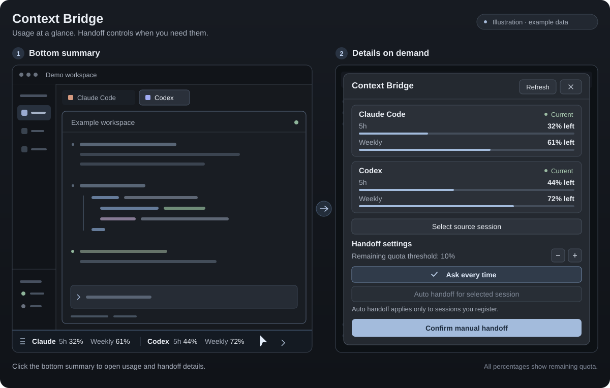

# Herdr Context Bridge

[English](README.md) | [한국어](README.ko.md) | [日本語](README.ja.md) | [简体中文](README.zh-CN.md)

A local macOS and native Windows tool for checking Claude Code, Codex, and AGY (Antigravity CLI) account quotas in Herdr. Claude/Codex work history can be handed off to a new terminal in the same working directory when a limit runs low. The default is **Ask every time**. Automatic handoff must be enabled explicitly for a source session you select.

It uses only Node.js built-in modules, with no separate web server or package installation required.

Providers appear after this helper observes account usage through an official interface: a successful Codex quota query, or valid Claude/AGY statusline quota data. Installation, settings files, and an AGY `authenticating` event alone do not count. Previously observed providers remain visible with unavailable or stale information when collection fails; this is an observation history, not a live login-status check. Existing valid usage caches are recognized. AGY currently supports usage display and alerts; conversation handoff remains available between Claude and Codex.



*Illustration with example data; not an actual screenshot.*

## Languages

The summary, details dialog, and helper support English (`en`), Korean (`ko`), Japanese (`ja`), and Mainland Simplified Chinese (`zh-CN`). On macOS they use the first preferred language. Unsupported languages, including Traditional Chinese, fall back to English; detection does not skip an unsupported first language to select another preferred language. On Windows, or when the macOS setting is unavailable, detection consults `LC_ALL`, `LC_MESSAGES`, `LANG`, then `Intl`. It does not query a separate Windows preferred-language API. There is no separate manual language setting. `node src/cli.mjs locale` reads the detected language as JSON, such as `{ "locale": "en" }`, without evaluating automatic handoff policy.

## Requirements

- macOS or native Windows, the Herdr app, and the `herdr-app` and `hc` commands. Written for Herdr 0.1.10.
- Node.js 22.5 or newer, `git` (Git for Windows on Windows), and the `claude` or `codex` CLI for each handoff provider. Windows requires `node` on the app's `PATH`.
- A currently signed-in local profile in each CLI. The helper launched by the app must also be able to find the CLIs through its `PATH`.
- A Codex version supporting `app-server`, the account usage API, and the full thread history API. New tabs targeting Codex use `--no-daemon`.
- Windows CLI discovery supports native `.exe`/`.com` programs and standard npm `.cmd` shims, whose Node or native targets are launched directly. Arbitrary `.cmd`/`.bat` shell scripts are not supported as CLI launchers, so prompt arguments do not pass through shell expansion.

CI is configured for `macos-latest` and `windows-latest`. This change was developed and checked on macOS; operation in the Windows Herdr desktop app has not yet been verified on a Windows machine.

Remote Herdr machines and simultaneous management of multiple authentication profiles are outside the scope of this tool. Before switching signed-in accounts, select **Ask every time**, then recheck usage and session bindings.

## Installation and removal

Launch Herdr once to create its default layout, then clone the repository and install. On macOS:

```sh
git clone https://github.com/photojupi/herdr-context-bridge.git
cd herdr-context-bridge
npm run install:mod -- --dry-run
npm run install:mod
herdr-app check ~/.config/herdr-app/mods/context-bridge
herdr-app do layout.switch '{"name":"context-bridge"}'
```

On Windows, use PowerShell:

```powershell
git clone https://github.com/photojupi/herdr-context-bridge.git
cd herdr-context-bridge
npm.cmd run install:mod -- --dry-run
npm.cmd run install:mod
herdr-app check "$env:USERPROFILE/.config/herdr-app/mods/context-bridge"
herdr-app do layout.switch --name context-bridge
```

The paths above assume the default Herdr configuration directory. Following [Herdr's `app_dir()`](https://github.com/herdrdev/herdr-app/blob/master/src/mods.rs), the installer uses `HERDR_APP_HOME`, then `XDG_CONFIG_HOME/herdr-app`, then `USERPROFILE/.config/herdr-app` on Windows or `HOME/.config/herdr-app` on macOS. If you set an override, use that directory in `herdr-app check` too. In this document, `~` means the corresponding user home directory.

By default, the installer copies the personal mod and helper to `~/.config/herdr-app/mods/context-bridge/` and places the quota summary alongside the existing bottom status bar in `layouts/context-bridge.json`, a copy of the default `main` layout. The row keeps the existing status bar height; a layout without a status bar gets one bottom row. Reinstalling replaces the former right panel with this layout without duplicating the summary. Built-in mods and the original `main.json` remain unchanged. The installation command itself does not switch the visible layout.

It adds a statusline wrapper and hooks to Claude's `~/.claude/settings.json`, and hooks to Codex's `~/.codex/hooks.json`. Existing hooks are preserved. The original Claude statusline command receives the original stdin, and its output and exit code are preserved. Initial configuration backups and a list of changed files are saved in `~/.local/state/herdr-context-bridge/install.json`. If you change the statusline command before reinstalling, the wrapper uses that new command as its original while preserving the initial file backup.

On Windows, the original Claude statusline runs through Git Bash when available, otherwise PowerShell; AGY retains the default Windows command shell. Handoff uses a Node launcher to preserve arguments and environment variables without requiring `/usr/bin/env`.

For AGY, it adds a wrapper to `~/.gemini/antigravity-cli/settings.json`. The original command's stdin, stdout, stderr, and exit code are preserved, as are existing statusline options. A new statusline stacks below AGY's built-in display. An explicitly disabled statusline stays disabled. Reinstall with `npm run install:mod` to add AGY support to an existing installation, then let your signed-in AGY session supply its normal statusline data. No test prompt is required. Before the first valid observation the provider stays hidden; **Refresh** only rereads Claude/AGY's collected data.

Codex may require you to trust installed hooks through its normal CLI procedure, such as `/hooks`. Existing sessions may not load new hooks immediately; use manual session binding below. Installing alone does not produce Claude usage data: it appears after an API response supplies statusline input in that session.

Before removal, switch back to your original layout. This example uses the default `main`.

```sh
herdr-app do layout.switch '{"name":"main"}'
npm run uninstall:mod -- --dry-run
npm run uninstall:mod
```

On Windows:

```powershell
herdr-app do layout.switch --name main
npm.cmd run uninstall:mod -- --dry-run
npm.cmd run uninstall:mod
```

The uninstaller removes the added hooks and statusline wrapper and restores the previous command. It preserves statusline options changed after installation and unrelated settings. Other managed files are removed or restored only if they still match their installed contents; user-edited files are left in place and listed under `preserved` in the result. **Original handoff records, work state, and backups remain after removal.** The last installation record stays in `last-install.json` in the same data directory.

## Usage

1. Check Claude and Codex's **5-hour and weekly remaining quota** in the bottom status row. Each provider and period stays distinct: values are never averaged or added together. Unknown values show `—`, stale values are marked, and valid values at or below the threshold show a warning. Codex periods use actual window metadata; unclear periods are not guessed. Click the summary to open full details with usage cards, reset/update times, **Refresh**, handoff settings, source selection, recent jobs, and the existing manual handoff review. Close the details dialog or press Escape to return to coding without resizing the terminal. The summary refreshes every 60 seconds; **Refresh** requests an update immediately.
2. In **Select source session**, choose a local terminal and inspect candidate sessions in the same working directory. You can also manually bind existing sessions that hooks did not connect. The most recent file is never automatically selected as the source.
3. In **Confirm manual handoff**, review the source, target, directory, and preservation scope, then select **Hand off**. Handoff is deferred while the source is working or waiting for ordinary approval.
4. In the target's new tab, verify delivery of the initial prompt, reading of the records, and resumption of work. **Target terminal opened** in the details dialog means a tab-creation response was received; it does not confirm that the model read every record.

The bottom summary shows the user-selected Gemini4 Argon bucket (`gemini-argon-wtu-weekly`) as **AGY Week XX%**. Its tooltip includes the model name, original bucket ID, and reset time. If this bucket is absent, the summary shows **AGY Week —** without falling back to another weekly bucket. This is the user's chosen representative item, not an automatic price comparison. Details and alerts retain all returned buckets under their original names. Periods are not guessed from names, buckets are not combined, and `remaining_amount` without a total is not converted into a percentage. Disabled buckets show unavailable usage. AGY alerts do not open a handoff confirmation.

The default remaining-quota threshold is 10%, adjustable from 1% to 50% in settings. An alert appears even if the first observed value is already at or below the threshold. Shared app state suppresses duplicate alerts for the same provider, usage window, and reset cycle. **Later** closes the confirmation dialog.

### Automatic handoff

Select a bound source and use **Auto handoff for selected session** to register it. All of the following are required:

- Automatic mode is enabled and that source session is registered.
- The source session, terminal, and working directory are bound, and the session is `idle` or `done`. A `blocked` state caused by a confirmed `rate_limit` error is also allowed.
- The source's latest valid remaining quota is at or below the threshold.
- The other provider's CLI is available and the target's latest valid remaining quota is above the threshold.
- No automatic attempt has been made for this source, and it was not created by an automatic handoff.

After preparation, the source state and automatic conditions are checked again. Automatic execution is disabled for unavailable collection, stale values, expired windows, unclear bindings, or active work. If target usage cannot be checked, manual confirmation is required. A lock prevents duplicate handoffs for the same source, and automatically created sessions are not automatically switched again. The new tab is created in the source terminal's local space; a space change during preparation aborts the handoff. A confirmed account identifier change across successive Codex queries clears automatic registration.

**Failed automatic handoffs are not retried automatically.** Inspect the error and retry manually. If the preparation process stops, a subsequent status query marks it as failed. If an interruption occurs after target creation has begun and the result is uncertain, the lock remains to prevent duplicates; check for a new handoff tab first. **Ask every time** clears automatic registration.

The bottom summary remains mounted while details are closed, so usage refresh, job polling, alerts, and automatic handoff monitoring continue. Its status queries in the app run the automatic policy. There is no separate service monitoring while the app is closed. An already-started handoff preparation worker is a separate process.

## What quota means and how authentication works

| Provider | Collection interface | Available information |
| --- | --- | --- |
| Codex | Official `codex app-server` → `account/rateLimits/read` | Multiple limit buckets and usage windows returned by the current CLI account. The older single `rateLimits` format is also supported |
| Claude Code | `rate_limits` in official `statusLine` stdin | Subscription/spending windows actually supplied to the statusline, such as 5-hour and 7-day windows. May be absent before the first API response |
| AGY (Antigravity CLI) | `quota` in official [`statusLine` stdin](https://antigravity.google/docs/cli/statusline/) | Named quota buckets with `remaining_fraction`, reset information, and optional `disabled`; amount-only buckets remain percentage-unknown |

The displayed value is the **remaining percentage in an account limit window**. It is not the remaining context tokens in a particular session or the number of requests you can still make. Missing values are not assumed to be 100%, and passing a reset time does not automatically make a window full. Values older than 10 minutes are marked stale; only fresh, valid values are used for automatic decisions. An explicit unavailable response from the official API is not treated as available capacity even if a percentage remains.

Usage collection is a read request that neither runs a conversation nor resumes a session, although the Codex CLI may make network requests and refresh its own authentication. The helper does not directly read authentication files, tokens, or Keychain, or extract credentials. It collects normalized usage, account identifiers supplied by the API, and necessary metadata such as session identifiers, paths, and terminal bindings.

## What is preserved?

- Claude's main conversation and discovered subagent JSONL files are copied at fixed byte boundaries with sizes and SHA-256 hashes. Original messages, tool calls/results, compaction summaries, and previous branches are retained.
- Codex raw rollouts are preserved when available, and every cursor page of the official `thread/turns/list` with `itemsView: full` is saved in ascending order. Storage formats without a raw path retain the official full history and explicitly note the absence of raw data.
- Large histories are never replaced with summaries or silently truncated at the end. Reading chunks and byte indexes are generated; a truncated final JSONL entry or a large unparseable record produces a warning.
- The working directory, Git HEAD, status, uncommitted diff, and staged diff are recorded. Source files and Git state are not changed, and diffs are not applied. This is not a separate project backup of untracked file contents.
- Image data and attachment references in the original records are retained, but copying or accessibility of external attachments is not guaranteed.

`START_HERE.md` in the handoff directory describes the reading order, latest branch, and compaction segments. It is stored with `manifest.json`, `records.jsonl`, `raw/`, `chunks/`, Codex `turns-*.json`, and `git-*.txt`. Failed exports are identified by `FAILED.json`. The target receives the path to this local index in its initial prompt instead of the full lengthy records.

The source session is neither terminated nor sent input. The target CLI retains its default approval and sandbox behavior; no permission-bypass options are added. **Preserving original records is different from cloning a model's entire context.** Running tools/processes, the model's internal neural state, and the original product's system prompt cannot be transferred. The target's context length and actual file reading also matter, so a perfect copy is not claimed before all records have been confirmed as read.

## Storage and commands

The default data directory is `USERPROFILE/.local/state/herdr-context-bridge` on Windows and `HOME/.local/state/herdr-context-bridge` on macOS. Configuration, usage caches, session bindings, handoff jobs, locks, `bundles/`, and installation backups are stored outside the source repository. On POSIX, new data directories use mode 0700 and files use 0600; Windows uses the user profile directory's ACL permissions. Bundles contain conversations and tool results; review their contents before sharing. There is no automatic retention period or deletion feature.

| Command | Purpose |
| --- | --- |
| `npm test` | Local regression tests |
| `npm run check` | JavaScript syntax checks |
| `node scripts/smoke.mjs` | Verify complete manual/automatic handoff execution boundaries with a temporary HOME and fake CLIs |
| `npm run install:mod -- --dry-run` | Preview installation paths to be changed |
| `npm run install:mod` | Install or update the personal mod, helper, layout, and hooks |
| `npm run uninstall:mod -- --dry-run` | Preview removal and preservation |
| `npm run uninstall:mod` | Remove installation changes and retain data |
| `node src/cli.mjs status` | Query usage, bindings, and jobs, and evaluate the current automatic policy |
| `node src/cli.mjs locale` | Read-only query of the detected display language |
| `node src/cli.mjs config` | Read current configuration |
| `node src/cli.mjs config '{"mode":"ask","autoSessions":[]}'` | Clear automatic registration |
| `node src/cli.mjs sessions claude /absolute/workdir` | List candidate Claude sessions; `codex` is also supported |
| `node src/cli.mjs bind '<JSON>'` | Bind a candidate using `terminalId`, `provider`, `id`, and `cwd` |
| `node src/cli.mjs handoff '<JSON>'` | Request a manual handoff using `sourceKey`, `target`, `automatic:false`, and optional `space` |
| `node src/cli.mjs job <jobId>` | Query a specific handoff job |

Public query/configuration/handoff commands output JSON and return `{ "error": "…" }` with a failing exit code on error. `capture`, `statusline`, `worker`, and `launch` are internal commands used by installed hooks and the helper. `status` can trigger execution in automatic mode; do not treat it as a read-only query.

| Environment variable | Purpose |
| --- | --- |
| `HERDR_BRIDGE_STATE_DIR` | Override the helper data directory. Recommended for development and isolated tests; the installer, app, and hooks must use the same value |
| `HERDR_APP_HOME` | Override the target Herdr configuration directory; takes precedence over `XDG_CONFIG_HOME` |
| `XDG_CONFIG_HOME` | Herdr configuration base; uses its `herdr-app` subdirectory when `HERDR_APP_HOME` is unset |
| `HC_TERMINAL_ID` | Source terminal identifier passed by Herdr to hooks |

The installer targets the default `~/.claude` and `~/.codex` configuration directories. Configurations using multiple separate CLI authentication/configuration directories are outside the scope of this installation flow.

For operation and layout details, see [RECIPE.md](RECIPE.md); for changes, see [CHANGELOG.md](CHANGELOG.md). Official interfaces are documented in [Codex app-server](https://learn.chatgpt.com/docs/app-server), [Codex hooks](https://learn.chatgpt.com/docs/hooks), [Claude statusline](https://code.claude.com/docs/en/statusline), and [Claude hooks](https://code.claude.com/docs/en/hooks).

## License

Licensed under the [MIT License](LICENSE). Copyright (c) 2026 photojupi.
