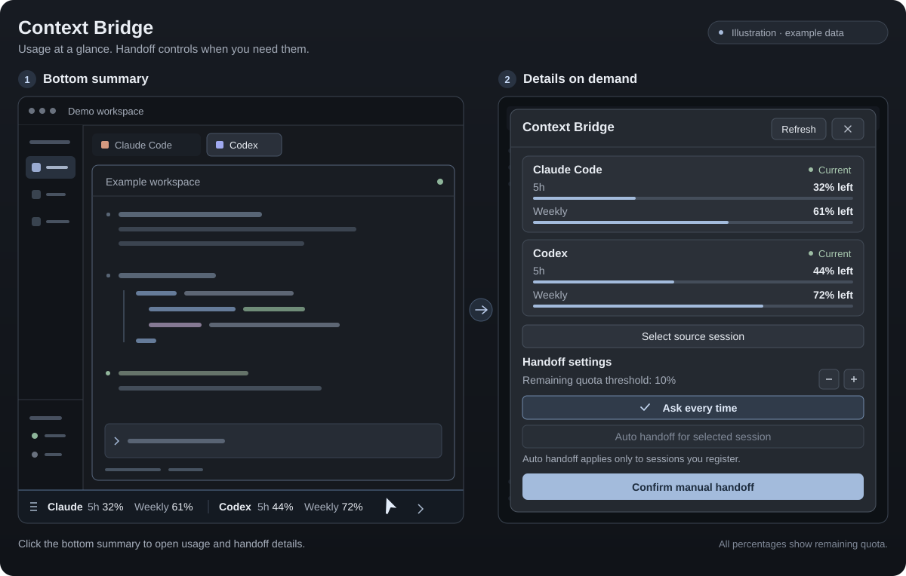

# Herdr Context Bridge

[English](README.md) | [한국어](README.ko.md) | [日本語](README.ja.md) | [简体中文](README.zh-CN.md)

这是一个本地 macOS 工具，用于在 Herdr 中查看 Claude Code 和 Codex 账户的剩余额度，并在额度不足时，将工作记录交接到同一工作目录下的新终端。默认模式为 **每次批准**。自动交接必须由用户针对选定的来源会话明确启用。

仅使用 Node.js 内置模块，无需单独的 Web 服务器或安装额外软件包。



*这是使用示例数据绘制的示意图，并非实际截图。*

## 支持语言

底部摘要、详情窗口和 helper 支持英语（`en`）、韩语（`ko`）、日语（`ja`）及中国大陆简体中文（`zh-CN`）。使用 macOS 首选语言列表中的第一种语言；不支持的语言（包括繁体中文）会回退为英语，不会跳过不支持的第一种语言而选择列表中的其他语言。只有无法读取 macOS 语言设置时，才依次检查 `LC_ALL`、`LC_MESSAGES`、`LANG` 和 `Intl`。没有单独的手动语言设置。`node src/cli.mjs locale` 以 JSON（例如 `{ "locale": "zh-CN" }`）返回检测到的语言，不执行自动交接策略评估。

## 环境要求

- macOS、Herdr 应用，以及 `herdr-app` 和 `hc` 命令。本工具面向 Herdr 0.1.10 编写。
- Node.js 22.5 或更高版本、`git`，以及交接所需提供方的 `claude`、`codex` CLI。
- 各 CLI 中已正常登录的当前本地配置。应用启动的 helper 也必须能通过其 `PATH` 找到对应 CLI。
- 支持 `app-server`、账户用量 API 和 full thread history API 的 Codex 版本。为 Codex 新建目标标签页时使用 `--no-daemon`。

本工具不支持远程 Herdr 机器，也不支持同时管理多个认证配置。切换登录账户前，请先选择 **每次批准**，再重新检查用量与会话绑定。

## 安装与卸载

先启动一次 Herdr，生成默认布局，然后克隆仓库并安装：

```sh
git clone https://github.com/photojupi/herdr-context-bridge.git
cd herdr-context-bridge
npm run install:mod -- --dry-run
npm run install:mod
herdr-app check ~/.config/herdr-app/mods/context-bridge
herdr-app do layout.switch '{"name":"context-bridge"}'
```

安装程序会将个人 mod 和 helper 复制到 `~/.config/herdr-app/mods/context-bridge/`，并在默认 `main` 布局的副本 `layouts/context-bridge.json` 中，将额度摘要放在现有底部状态栏的同一行。保持状态栏原有高度；没有状态栏的布局会新增底部一行。重新安装会将原右侧面板替换为此布局，不会重复添加摘要。不会修改内置 mod 或原始 `main.json`。安装命令本身不会切换当前显示的布局。

安装程序会在 Claude 的 `~/.claude/settings.json` 中添加状态栏 wrapper 和 hooks，并在 Codex 的 `~/.codex/hooks.json` 中添加 hooks。保留已有 hooks。原有 Claude 状态栏命令仍会收到原始 stdin，其输出和退出码也会保留。首次配置备份和变更文件列表保存在 `~/.local/state/herdr-context-bridge/install.json`。如果用户在重新安装前修改了状态栏命令，wrapper 会改用该新命令作为原始命令，同时保留首次文件备份。

Codex 可能要求通过 `/hooks` 等 CLI 正常流程信任已安装的 hooks。已有会话可能不会立即加载新 hooks，请使用下文的手动会话绑定。仅完成安装不会产生 Claude 用量数据；对应会话在 API 响应后收到状态栏输入，才会显示用量。

卸载前请先切回原来的布局。以下示例使用默认 `main`：

```sh
herdr-app do layout.switch '{"name":"main"}'
npm run uninstall:mod -- --dry-run
npm run uninstall:mod
```

卸载程序会移除添加的 hooks 和状态栏 wrapper，恢复原有命令。安装后修改的状态栏选项及无关设置会保留。其他受管理文件也仅在内容与安装时一致的情况下才会被删除或恢复；用户修改过的文件会保留，并在结果的 `preserved` 中列出。**卸载后仍保留交接原文、工作状态和备份。** 最后一次安装记录会保存在同一数据目录的 `last-install.json` 中。

## 使用方法

1. 在底部状态栏行中查看 Claude 和 Codex 的 **5 小时及每周剩余额度**。提供方与期间分别标识，不进行平均或合并。无法查询的值显示为 `—`，陈旧值会单独标记，有效剩余额度不高于阈值时显示警告。Codex 的期间使用实际窗口元数据，不推测含义不明的期间。点击摘要可打开完整详情窗口，其中包含用量卡片、重置与更新时间、**刷新**、交接设置、来源选择、最近任务及原有手动交接确认。关闭详情窗口或按 Escape，即可返回编码界面，终端大小不变。每 60 秒刷新一次，也可通过 **刷新** 手动查询。
2. 在 **选择来源会话** 中选择本地终端，并查看同一工作目录下的候选会话。未被 hooks 自动关联的已有会话也可以在此手动绑定。不会自动将最新文件选为来源。
3. 在 **确认手动交接** 中核对来源、目标、目录和保留范围后，点击 **交接**。来源正在工作或等待常规批准时会暂缓交接。
4. 在目标的新标签页中，确认初始提示词已送达、记录已读取且工作已恢复。详情窗口中的 **已启动目标终端** 仅表示收到标签页创建响应，并不表示模型已经读取所有记录。

剩余额度阈值默认为 10%，可在设置中调整为 1%～50%。即使首次观测值已不高于阈值，也会发出提醒。应用的共享状态会抑制同一提供方、用量窗口和重置周期内的重复提醒。点击 **稍后** 会关闭确认窗口。

### 自动交接

选择已绑定的来源，点击 **自动交接所选会话** 进行注册。必须同时满足以下条件：

- 处于自动模式，且该来源会话已注册。
- 来源会话、终端和工作目录已绑定，状态为 `idle` 或 `done`。因已确认的 `rate_limit` 错误而处于 `blocked` 状态也允许交接。
- 来源最新且有效的剩余额度不高于阈值。
- 另一提供方的 CLI 可用，且目标最新且有效的剩余额度高于阈值。
- 没有对同一来源发起自动尝试的历史，且该会话不是由自动交接创建的。

准备完成后会再次检查来源状态和自动执行条件。无法采集、数值陈旧、窗口过期、绑定不明确或正在工作时，不会自动执行。如果无法确认目标用量，则需要手动确认。通过锁避免同一来源重复执行；自动创建的会话不会再次自动切换。新标签页在来源终端的本地空间中创建，准备期间空间发生变化则中止交接。如果连续的 Codex 查询确认账户标识发生变化，会清除自动注册。

**失败的自动交接不会自动重试。** 请查看错误后手动重试。如果准备进程中断，后续状态查询会将其标记为失败。如果已经开始创建目标，但中断导致结果不明确，会为防止重复而保留锁；请先检查是否已存在新的交接标签页。**每次批准** 按钮会清除自动注册。

关闭详情窗口后，底部摘要仍保持运行，继续刷新用量、查询任务、提醒及监控自动交接。应用底部摘要的状态查询会执行自动策略。应用关闭期间没有单独的后台服务持续监控。已经开始的交接准备 worker 是独立进程。

## 额度的含义与认证

| 提供方 | 采集接口 | 可获取的信息 |
| --- | --- | --- |
| Codex | 官方 `codex app-server` 的 `account/rateLimits/read` | 当前 CLI 账户返回的多个限制 bucket 和用量窗口。也支持旧版单一 `rateLimits` 格式 |
| Claude Code | 官方 `statusLine` stdin 中的 `rate_limits` | 实际传入状态栏的订阅／支出窗口，如 5 小时、7 天等。首次 API 响应前可能不存在 |

显示值是 **账户限制窗口中的剩余百分比**，不是某个会话的剩余上下文 token，也不是未来可发送的请求次数。不会将缺失值假定为 100%，也不会因为重置时间已过就自动视为满额。超过 10 分钟的值会标记为陈旧信息；自动判断仅使用最新且有效的值。如果官方 API 明确表示不可用，即使仍有百分比，也不会将其视为可用额度。

用量查询是只读请求，不会执行对话或恢复会话，但 Codex CLI 可能发起网络请求并自行刷新认证。helper 不会直接读取认证文件、token 或 Keychain，也不会提取凭据。采集内容仅包括规范化用量、API 提供的账户标识，以及会话标识、路径、终端绑定等必要元数据。

## 保留哪些内容？

- 按固定字节边界复制 Claude 主对话及发现的 subagent JSONL 文件，并记录大小与 SHA-256。保留原始消息、工具调用与结果、压缩摘要及先前的 branch。
- 尽可能保留 Codex raw rollout，并通过官方 `thread/turns/list` 的 `itemsView: full`，按升序保存全部 cursor 分页。没有 raw 路径的存储格式会保留官方 full history，并明确注明 raw 缺失。
- 即使记录很大，也不会用摘要替换原文或静默丢弃末尾。会生成读取分片和字节索引，并对末尾截断的 JSONL、无法解析的大型 record 等情况留下警告。
- 记录工作目录、Git HEAD、状态、未提交 diff 和 staged diff。不会修改源文件或 Git 状态，也不会应用 diff。本工具不提供包含未跟踪文件内容的独立项目备份。
- 保留原文中的图像数据和附件引用，但不保证复制外部附件本身，也不保证其可访问性。

交接目录中的 `START_HERE.md` 会说明读取顺序、最新 branch 和压缩区段。它与 `manifest.json`、`records.jsonl`、`raw/`、`chunks/`、Codex 的 `turns-*.json` 及 `git-*.txt` 一同保存。失败的导出用 `FAILED.json` 区分。目标收到的初始提示词是该本地索引的路径，而不是冗长的全部原文。

不会终止来源会话，也不会向其发送输入。保留目标 CLI 默认的批准与沙箱行为，不添加绕过权限的选项。**保存原文不等于复制模型的完整上下文。** 正在运行的工具和进程、模型内部神经网络状态，以及原产品的系统提示词都无法迁移。目标上下文长度和实际文件读取范围也会产生影响，因此在确认所有记录均已读取前，不会宣称已完成完美复制。

## 存储位置与命令

默认数据目录为 `~/.local/state/herdr-context-bridge`。配置、用量缓存、会话绑定、交接 jobs、锁、`bundles/` 和安装备份均保存在源代码仓库之外。新建数据目录权限为 0700，文件权限为 0600。bundle 包含对话和工具结果，分享前请检查内容。没有自动保留期限或删除功能。

| 命令 | 用途 |
| --- | --- |
| `npm test` | 本地回归测试 |
| `npm run check` | JavaScript 语法检查 |
| `node scripts/smoke.mjs` | 使用临时 HOME 和模拟 CLI，验证手动及自动交接的完整执行边界 |
| `npm run install:mod -- --dry-run` | 预览安装将修改的路径 |
| `npm run install:mod` | 安装或更新个人 mod、helper、布局和 hooks |
| `npm run uninstall:mod -- --dry-run` | 预览删除与保留的内容 |
| `npm run uninstall:mod` | 移除安装变更，保留数据 |
| `node src/cli.mjs status` | 查询用量、绑定、jobs，并评估当前自动策略 |
| `node src/cli.mjs locale` | 只读查询检测到的显示语言 |
| `node src/cli.mjs config` | 查询当前配置 |
| `node src/cli.mjs config '{"mode":"ask","autoSessions":[]}'` | 清除自动注册 |
| `node src/cli.mjs sessions claude /absolute/workdir` | 查询 Claude 候选会话，也支持 `codex` |
| `node src/cli.mjs bind '<JSON>'` | 使用 `terminalId`、`provider`、`id` 和 `cwd` 绑定候选会话 |
| `node src/cli.mjs handoff '<JSON>'` | 使用 `sourceKey`、`target`、`automatic:false` 及可选 `space` 请求手动交接 |
| `node src/cli.mjs job <jobId>` | 查询指定交接任务 |

公开的查询、配置和交接命令均输出 JSON；出错时返回 `{ "error": "…" }` 和非零退出码。`capture`、`statusline` 和 `worker` 是已安装 hooks 与 helper 使用的内部命令。`status` 在自动模式下可能触发执行，请勿将其视为纯只读查询。

| 环境变量 | 用途 |
| --- | --- |
| `HERDR_BRIDGE_STATE_DIR` | 修改 helper 数据路径。建议用于开发与隔离测试；安装程序、应用和 hooks 必须使用相同值 |
| `HERDR_APP_HOME` | 修改 Herdr 安装目标配置目录，默认为 `~/.config/herdr-app` |
| `HC_TERMINAL_ID` | Herdr 传给 hooks 的来源终端标识 |

安装程序针对默认的 `~/.claude` 和 `~/.codex` 配置目录。使用多个独立 CLI 认证或配置目录的部署方式，不在此安装流程的支持范围内。

运行与界面布局请参阅 [RECIPE.md](RECIPE.md)，变更记录请参阅 [CHANGELOG.md](CHANGELOG.md)。官方接口说明见 [Codex app-server](https://learn.chatgpt.com/docs/app-server)、[Codex hooks](https://learn.chatgpt.com/docs/hooks)、[Claude 状态栏](https://code.claude.com/docs/en/statusline) 和 [Claude hooks](https://code.claude.com/docs/en/hooks)。

## 许可证

本项目采用 [MIT 许可证](LICENSE)。Copyright (c) 2026 photojupi.
